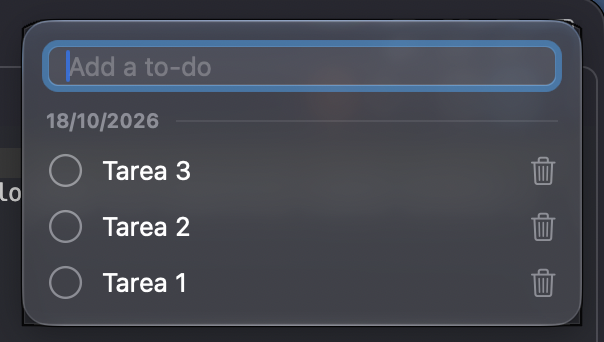

# sp-todo-list

Lista de tareas para macOS que vive en un panel flotante, fijo en la esquina superior derecha de la pantalla y siempre por encima del resto de las ventanas.

La idea es simple: tu lista de tareas debe estar siempre a la vista, sin cambiar de app, sin abrir ventanas y sin que te quite el foco de lo que estás haciendo.



## Por qué es distinta

La mayoría de las apps de tareas son ventanas normales: se tapan con otras ventanas, hay que buscarlas en el Dock y roban el foco al abrirlas. `sp-todo-list` prioriza que la lista siempre esté visible:

- **Siempre encima de todo.** El panel se muestra por encima de las demás ventanas, incluso de las apps en pantalla completa, y aparece en todos los Spaces.
- **Fijo y predecible.** Está anclado arriba a la derecha, justo debajo de la barra de menú del monitor principal. No se arrastra ni se pierde. Si cambia la resolución o la configuración de pantallas, vuelve solo a su lugar.
- **No te quita el foco.** Podés escribir una tarea nueva sin que la app pase al frente: la app en la que estabas trabajando sigue siendo la activa.
- **Sin ruido.** No tiene ícono en el Dock. Se controla desde un ítem en la barra de menú.
- **La lista es lo único importante.** Sin menús, pestañas ni ajustes: agregar, marcar como hecha y borrar.

## Funciones

- Agregar, marcar como hecha y borrar tareas.
- Tareas ordenadas de la más nueva a la más vieja, agrupadas por día con un separador de fecha (`dd/MM/yyyy`).
- Opción **Show only today** en el menú de la barra para ocultar las tareas de otros días. Arranca desactivada y la app recuerda tu elección al reabrirla.
- El panel crece con el contenido y hace scroll cuando la lista es larga.
- Aspecto translúcido tipo vidrio. En macOS 26 o superior usa el efecto de vidrio del sistema; en versiones anteriores usa un material translúcido.
- Las tareas se guardan automáticamente y reaparecen al volver a abrir la app.

## Requisitos

- macOS 14 o superior.
- Swift 6.0 o superior (el proyecto se desarrolla con Xcode 27 y Swift 6.4).

## Compilar y ejecutar

No hace falta abrir Xcode: es un paquete de Swift Package Manager.

Clonar el repositorio:

```sh
git clone https://github.com/sbpinilla/sp-todo-list.git
cd sp-todo-list
```

Compilar y ejecutar en modo desarrollo:

```sh
swift run SpTodoList
```

Compilar en modo release:

```sh
swift build -c release
```

El ejecutable queda en `.build/release/SpTodoList`:

```sh
.build/release/SpTodoList
```

Para cerrar la app, usá el ítem de la barra de menú y elegí **Quit**.

### Pruebas

```sh
swift test
```

## Dónde se guardan los datos

Las tareas se guardan en un archivo JSON:

```
~/Library/Application Support/sp-todo-list/todos.json
```

Si el archivo está dañado, la app lo renombra a `todos.corrupt-<fecha>.json` en la misma carpeta y arranca con una lista vacía, sin sobrescribirlo. Por ahora no muestra ningún aviso cuando eso ocurre.

La preferencia **Show only today** se guarda aparte, en `UserDefaults`.

## Arquitectura

El código sigue una arquitectura hexagonal, dividida en módulos de Swift Package Manager:

| Módulo | Responsabilidad |
|---|---|
| `TodoDomain` | Entidad `TodoItem`. |
| `TodoApplication` | Casos de uso, puertos, agrupación por día y view model. |
| `TodoInfrastructure` | Repositorio JSON, preferencias y panel flotante (AppKit). |
| `TodoUI` | Vistas de SwiftUI. |
| `SpTodoList` | Ejecutable y raíz de composición. |

Las especificaciones y el historial de los cambios están en la carpeta `openspec/`.

## Limitaciones conocidas

- Por ahora se ejecuta con `swift run` o con el binario compilado: no hay un paquete `.app` firmado ni inicio automático al encender el Mac.
- El agrupado por día no se actualiza solo a medianoche: si dejás la app abierta pasada la medianoche, "hoy" se recalcula en la próxima acción.
- El panel solo se muestra en el monitor principal.
- No se pueden editar ni reordenar las tareas.
- La accesibilidad con VoiceOver no se ha verificado.

## Licencia

Distribuido bajo la licencia MIT. Consultá el archivo [LICENSE](LICENSE).
